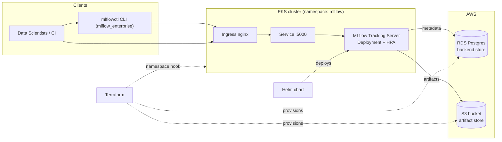

# mlflow-enterprise

Production-grade, infrastructure-first deployment of [MLflow](https://mlflow.org/)
— a tracking server and model registry backed by AWS RDS Postgres and an S3
artifact store, provisioned with Terraform and deployed to Kubernetes with Helm.


## Overview

`mlflow-enterprise` packages everything a platform team needs to run MLflow as a
shared, multi-team service. The **backing infrastructure leads**: Terraform
provisions the durable stores (an encrypted, versioned S3 bucket for artifacts
and a managed RDS Postgres instance for the tracking/registry backend) and hooks
a namespace into an existing EKS cluster. A Helm chart then deploys the MLflow
tracking server against those stores.

A small, typed Python layer (`mlflow_enterprise`) and the `mlflowctl` CLI give
data scientists and CI pipelines a thin, opinionated wrapper over the MLflow
tracking client for the operations that matter most: logging experiment runs,
registering models, and promoting model versions between lifecycle stages.

It is intended for platform/MLOps engineers who want a coherent,
environment-aware (dev/prod) reference rather than a one-off `mlflow server`
process on a laptop.

## Architecture



**Components**

- **Terraform root module** — orchestrates `modules/artifact-store` (S3 + IAM
  policy) and `modules/backend-db` (RDS Postgres + security group), plus a
  Kubernetes namespace hook into an existing EKS cluster.
- **Helm chart (`helm/mlflow`)** — deployment, service, ingress, HPA,
  service account, and config map for the tracking server on port 5000.
- **Python layer (`src/mlflow_enterprise`)** — configuration, a typed client
  wrapper, and the `mlflowctl` Click CLI.

## Features

- Infrastructure-as-code for the full MLflow backing stack (S3 + RDS + namespace).
- Encrypted, versioned artifact bucket with least-privilege IAM access policy.
- Managed Postgres backend with deletion protection and automated backups.
- Reusable Terraform submodules and separate `dev`/`prod` environments.
- Helm chart with autoscaling (HPA), ingress/TLS, and a secret-backed DB password.
- Typed Python client and `mlflowctl` CLI for register/promote workflows.
- Full CI: Python lint/test, `terraform fmt`/`validate`, `tflint`, `helm lint`,
  and a Docker build.

## Tech Stack

| Layer            | Technology                                    |
| ---------------- | --------------------------------------------- |
| Infrastructure   | Terraform (AWS provider), S3, RDS Postgres    |
| Orchestration    | Kubernetes (EKS), Helm 3                       |
| Application      | MLflow tracking server + model registry       |
| Tooling          | Python 3.11+, Click, pydantic-settings, boto3 |
| CI/CD            | GitHub Actions, pre-commit                     |

## Getting Started

### Prerequisites

- Terraform >= 1.5, an AWS account, and an existing EKS cluster
- `kubectl` and Helm 3
- Python 3.11+ (for the client/CLI)

### Install the Python layer

```bash
make install          # pip install -e ".[dev]"
mlflowctl --help
```

### Provision infrastructure (dev)

```bash
cd terraform
terraform init -backend-config=environments/dev/backend.hcl
terraform plan  -var-file=environments/dev/terraform.tfvars
terraform apply -var-file=environments/dev/terraform.tfvars
```

### Deploy the tracking server

```bash
kubectl -n mlflow create secret generic mlflow-backend-store \
  --from-literal=password="$DB_PASSWORD"

helm upgrade --install mlflow helm/mlflow -n mlflow \
  --set backendStore.host="$(terraform -chdir=terraform output -raw db_endpoint)" \
  --set artifactStore.defaultArtifactRoot="$(terraform -chdir=terraform output -raw artifact_uri)"
```

### Use the CLI

```bash
export MLFLOW_ENT_TRACKING_URI=https://mlflow.example.com
mlflowctl config
mlflowctl register --model-uri runs:/<run_id>/model --name fraud-detector
mlflowctl promote  --name fraud-detector --version 3 --stage Production
```

## Project Structure

```text
mlflow-enterprise/
├── terraform/                  # Primary infrastructure (leads)
│   ├── main.tf variables.tf outputs.tf versions.tf providers.tf
│   ├── terraform.tfvars.example
│   ├── modules/
│   │   ├── artifact-store/      # S3 bucket + IAM access policy
│   │   └── backend-db/          # RDS Postgres + security group
│   └── environments/
│       ├── dev/                 # tfvars + backend.hcl
│       └── prod/                # tfvars + backend.hcl
├── helm/mlflow/                # Tracking server chart
│   ├── Chart.yaml values.yaml
│   └── templates/              # deployment, service, ingress, hpa, sa, configmap, _helpers.tpl
├── src/mlflow_enterprise/      # Python client + CLI
│   ├── config.py client.py cli.py
├── tests/                      # pytest (import + unit)
├── docs/runbook.md
├── Dockerfile                  # mlflowctl helper image
└── .github/workflows/ci.yml
```

## Configuration

Client/CLI settings are read from environment variables (prefix `MLFLOW_ENT_`)
or a `.env` file. See [`.env.example`](.env.example).

| Variable                             | Default                  | Description                                     |
| ------------------------------------ | ------------------------ | ----------------------------------------------- |
| `MLFLOW_ENT_TRACKING_URI`            | `http://localhost:5000`  | Tracking server URI (MLflow default port 5000). |
| `MLFLOW_ENT_REGISTRY_URI`            | *(tracking URI)*         | Optional dedicated model registry URI.          |
| `MLFLOW_ENT_EXPERIMENT_NAME`         | `Default`                | Default experiment name.                        |
| `MLFLOW_ENT_ARTIFACT_LOCATION`       | *(none)*                 | S3 artifact root, e.g. `s3://.../`.             |
| `MLFLOW_ENT_REQUEST_TIMEOUT_SECONDS` | `30`                     | Tracking server HTTP timeout.                   |

Key Terraform variables (see `terraform/terraform.tfvars.example`):
`aws_region`, `environment`, `eks_cluster_name`, `artifact_bucket_name`,
`db_instance_class`, `vpc_id`, `db_subnet_ids`.

## Deployment

- **Terraform** provisions the stores and namespace; use the
  `environments/{dev,prod}` tfvars and `backend.hcl` files.
- **Helm** (`helm/mlflow`) deploys the tracking server; the DB password is read
  from a pre-existing Kubernetes secret and never templated in plaintext.
- **Docker** — `make docker-build` builds the `mlflowctl` helper image.

See [`docs/runbook.md`](docs/runbook.md) for step-by-step operational procedures.

## Contributing

Contributions are welcome — see [CONTRIBUTING.md](CONTRIBUTING.md) and our
[CODE_OF_CONDUCT.md](CODE_OF_CONDUCT.md).

## Security

Please report vulnerabilities as described in [SECURITY.md](SECURITY.md).

## License

Released under the [MIT License](LICENSE).
